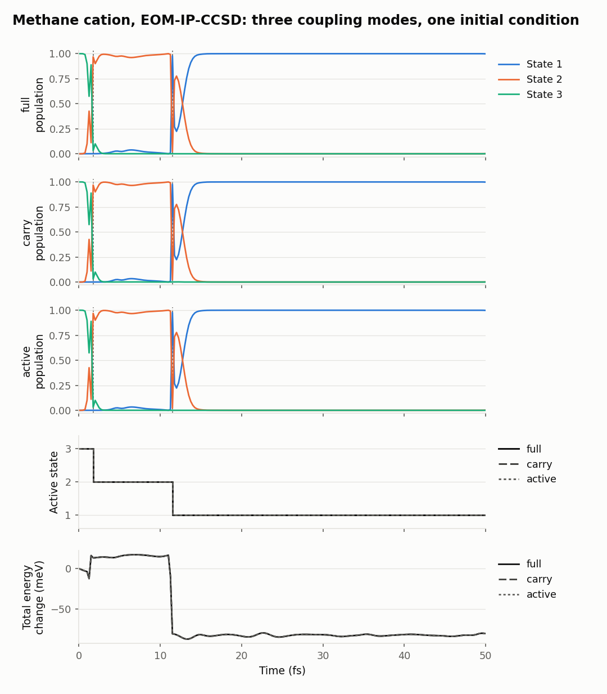

[Home](../../README.md) / Benchmarks

# Benchmarks

What makes a step cheaper, and what each option costs in accuracy. Raw inputs, outputs and numbers are in [`data/`](data).

## Verdicts

| Option | Verdict |
|---|---|
| Orbital reuse between steps (`reuse_guess = 1`) | **Use it** (default). SCF 11 → 2 cycles; job 15.8 → 11.2 s; identical energies. |
| Several jobs in one Q-Chem input (`nac_mode` `nx`/`full`) | **Automatic.** Later jobs reuse the geometry and orbitals: 13.2 s against 15.9 s for the first. |
| Reusing gradients after a hop | **Automatic.** Saves one full Q-Chem step per hop; gradients are identical whichever state a job targets. |
| Gradient-only steps (`vdoth = 2`, adiabatic steps, `thres`) | **Biggest saving.** One gradient job takes 36% less time than a coupling job and replaces n − 1 of them. |
| Tight thresholds (10⁻⁹) | **Recommended** for production. Cost +27% per job; removes errors of about 10 μEh in energies and 6 × 10⁻³ a.u. in couplings. |
| Cholesky (`CHOLESKY_TOL`) or RI (`AUX_BASIS`) integrals | **Not usable with couplings** in Q-Chem 5.4.1 (crash). With gradient-only jobs they run, but give no gain for small molecules, and RI costs accuracy. |
| Single precision (`CC_SINGLE_PREC`, `EOM_SINGLE_PREC`) | **No gain.** Mixed-precision EOM is not implemented; mixed CCSD is no faster; full single precision is 7% faster than default double precision at the same accuracy as default thresholds. |
| Coupling modes `carry` / `active` | **Half the cost** of `full` with 3 states, and the same trajectory for the methane cation; see [Coupling modes](#coupling-modes). |
| `CC_BACKEND XM` | **Avoid** for small and medium molecules: twice as slow. |

## Q-Chem options for one coupling job

Methaniminium (CH₂NH₂⁺), EOM-EE-CCSD/cc-pVDZ, 3 states, `CC_STATE_TO_OPT [1,2]`, `CALC_NAC 2`. "Tight" means `SCF_CONVERGENCE 9`, `CC_CONVERGENCE 9`, `EOM_DAVIDSON_CONVERGENCE 9`. Errors are maximum absolute differences from the tight double-precision job: energies of all states, gradients of all states, and coupling magnitudes; cos θ is the smallest overlap of coupling directions.

| Variant | Extra keywords | Wall time (s) | Energy error (μEh) | Gradient error (a.u.) | Coupling error (a.u.) | min cos θ |
|---|---|---|---|---|---|---|
| default thresholds | none | 25.7 | 12.0 | 2.1 × 10⁻⁴ | 5.6 × 10⁻³ | 0.99987 |
| **tight (reference)** | tight | 32.6 | 0 | 0 | 0 | 1 |
| tight, mixed-precision CCSD | `CC_SINGLE_PREC 2` | 34.3 | 0.0 | 0 | 1 × 10⁻⁸ | 1.00000 |
| tight, XM back-end | `CC_BACKEND XM` | 64.3 | 0.0 | 0 | 0 | 1.00000 |
| single precision | `CC_SINGLE_PREC 1`, `EOM_SINGLE_PREC 1`, `EOM_ARESP_SINGLE_PREC 1` | 24.0 | 10.9 | 2.0 × 10⁻⁴ | 5.5 × 10⁻³ | 0.99987 |
| tight, Cholesky | `CHOLESKY_TOL 4` | crash: `Key 'i5_vvvv_float' is not known` | | | | |
| tight, RI | `AUX_BASIS rimp2-cc-pVDZ` | crash: same message | | | | |
| tight, mixed-precision EOM | `CC_SINGLE_PREC 2`, `EOM_SINGLE_PREC 2` | stops: `Mixed-Precision EOM is not yet implemented!` | | | | |

## Gradient-only jobs

The same molecule and target state with `JOBTYPE FORCE` instead of `CALC_NAC 2`, as used for `vdoth = 2` and adiabatic steps. Errors are against the gradient of the tight coupling job.

| Variant | Wall time (s) | Energy error (μEh) | Gradient error (a.u.) |
|---|---|---|---|
| tight | 20.7 | 0 | 0 |
| tight, Cholesky (`CHOLESKY_TOL 4`) | 23.6 | 15.0 | 2.1 × 10⁻⁵ |
| tight, RI (`AUX_BASIS rimp2-cc-pVDZ`) | 22.7 | 278.9 | 1.5 × 10⁻⁴ |

## Interface features

Methane cation, EOM-IP-CCSD/cc-pVDZ, 3 states, default thresholds.

| Measurement | Result |
|---|---|
| SCF started from the previous orbitals (`reuse_guess`) | 11 → 2 SCF cycles; job 15.8 → 11.2 s; energies identical |
| Second job of a two-job input (same geometry, orbitals read) | 13.2 s, against 15.9 s for the first. It targets a different state (1 instead of 3), so it is not directly comparable with the 11.2 s above. |
| Gradient of each state from jobs targeting different states | identical (difference 0.0) |
| `Full Analytical Gradient` of a gradient-only job against `G_I` of a coupling job | 7.6 × 10⁻⁵ a.u. (convergence noise at default thresholds) |

## Coupling modes

The three [methane-cation examples](../../examples/README.md) start from one initial condition (same geometry, velocities and random seed) and differ only in `nac_mode`. EOM-IP-CCSD/cc-pVDZ, 3 states, tight thresholds, dt 0.25 fs, 50 fs.

| `nac_mode` | Q-Chem jobs per step | Cost per step (median, 4 cores) | Hops | Total energy against `full` | Populations against `full` |
|---|---|---|---|---|---|
| `full` | 2 | 60 s | 3 → 2 at 1.75 fs, 2 → 1 at 11.5 fs | reference | reference |
| `carry` | 1 | 30 s | same | identical (< 0.01 meV) | within 0.006 |
| `active` | 1 | 29 s | same | identical (< 0.01 meV) | within 0.006 |

**Verdict.** `carry` and `active` halve the cost here with no visible change in the trajectory. With 3 states they skip one pair, the one between the two inactive states. With more states they skip more pairs, so the saving grows, and so may the error when two inactive states come close; compare with `full` on a few trajectories before production. The default (`nx`) computes what NewtonX asks for, which with its default settings is every pair, as in `full`.

The three runs shared the node at the same time, so their times compare with each other but not with the single-job timings above.

## How these were measured

Q-Chem 5.4.1 on one node (48 cores, 188 GB, shared with other jobs, so times vary by a few percent), 4 threads per job, jobs run one at a time. The inputs are in [`data/`](data) (`*.inp`), with gzipped outputs (`*.out.gz`), [`wall_times.txt`](data/wall_times.txt) and [`accuracy_vs_tight.txt`](data/accuracy_vs_tight.txt). The methane jobs of the interface table are in [`data/interface/`](data/interface), with their own [`wall_times.txt`](data/interface/wall_times.txt). Outputs of the variants that crashed or stopped at once (Cholesky, RI, mixed-precision EOM with couplings) are not kept; their messages are quoted in the table. The errors were computed with [`tools/compare_qchem_outputs.py`](../../tools/compare_qchem_outputs.py).

## See also

- [Settings reference](../par-reference.md)
- [Couplings](../couplings.md)
