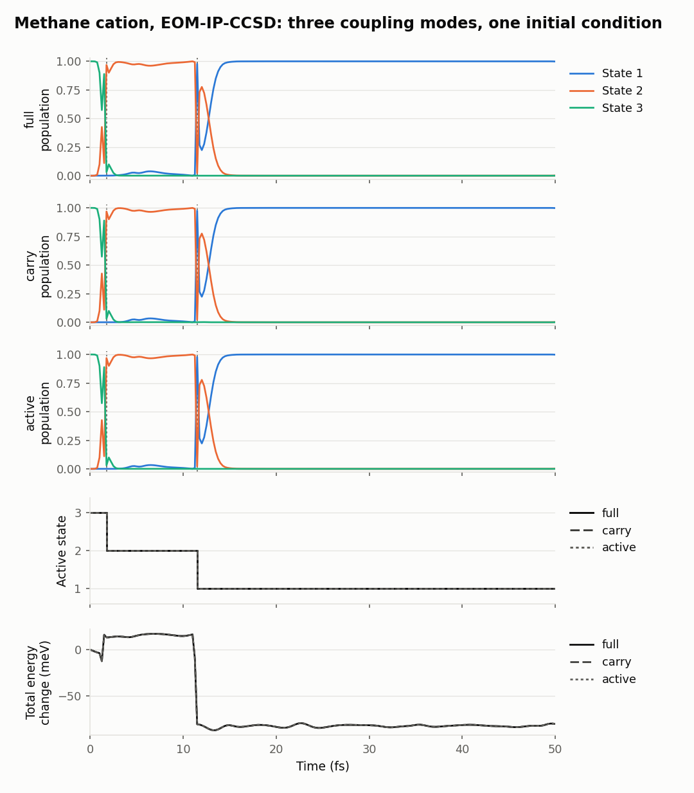

[Home](../README.md) / Validation

# Validation

This page collects every benchmark and validation run of the interface: what each Q-Chem option costs and what it changes in accuracy, how the coupling modes compare, and which checks pass with NewtonX 2.4 and 2.6. Read it when you choose settings for production or want to know what a statement elsewhere in the documentation rests on. Raw inputs, outputs and numbers are in [`validation/data/`](validation/data), figures in [`validation/figures/`](validation/figures).

## Summary

| # | Test | What it checks | Key number | Result |
|---|---|---|---|---|
| 1 | [Q-Chem options for one coupling job](#1-q-chem-options-for-one-coupling-job) | Cost and accuracy of thresholds, precision, back-end and integral options | Tight thresholds: 32.6 s against 25.7 s (+27%) | Tight recommended; Cholesky and RI crash with couplings; single precision and XM give no gain |
| 2 | [Gradient-only jobs](#2-gradient-only-jobs) | Cost and accuracy of `JOBTYPE FORCE` jobs with Cholesky and RI | 20.7 s against 32.6 s for a coupling job (−36%) | Gradient-only steps are the biggest saving; Cholesky and RI give no gain |
| 3 | [Interface features](#3-interface-features) | Orbital reuse, multi-job inputs, gradient reuse | SCF 11 → 2 cycles, job 15.8 → 11.2 s | Pass: identical energies and gradients |
| 4 | [Coupling modes](#coupling-modes) | `full`, `carry` and `active` on one methane-cation trajectory | 58, 28 and 27 s per step ([test 7](#7-cost-per-step-of-the-examples)) | Same hops; total energies within 0.01 meV; populations within 0.006 |
| 5 | [Regression tests](#5-regression-tests) | `tests/run_tests.sh` with NewtonX 2.4 and 2.6 | 42 tests | Pass on 2.4-B06 and 2.6-B01 |
| 6 | [NewtonX 2.6 compatibility](#6-newtonx-26-compatibility) | test-nx, coupling signs in mixed dynamics, initial conditions | NewtonX keeps every interface sign | Pass: same Q-Chem jobs, hops and initial conditions as 2.4 |
| 7 | [Cost per step of the examples](#7-cost-per-step-of-the-examples) | Median Q-Chem wall time per step of every example trajectory | 27 s (EOM-IP, `active`) to 152 s (EOM-SF) | Measured from the archived outputs |

## 1. Q-Chem options for one coupling job

**Purpose.** Find out which Q-Chem options make a coupling job cheaper, and what each one costs in accuracy.

**Setup.**

- **System.** Methaniminium (CH₂NH₂⁺), EOM-EE-CCSD/cc-pVDZ, 3 states, `CC_STATE_TO_OPT [1,2]`, `CALC_NAC 2`.
- **Tight thresholds.** `SCF_CONVERGENCE 9`, `CC_CONVERGENCE 9`, `EOM_DAVIDSON_CONVERGENCE 9`.
- **Errors.** Maximum absolute differences from the tight double-precision job: energies of all states, gradients of all states, and coupling magnitudes. cos θ is the smallest overlap of coupling directions. Computed with [`tools/compare_qchem_outputs.py`](../tools/compare_qchem_outputs.py).
- **Versions.** Q-Chem 5.4.1 (output headers). NewtonX and the interface are not involved: the jobs are plain Q-Chem inputs, run one at a time. Data added with interface commit `123f5e1`.
- **Conditions.** One node (48 cores, 188 GB), 4 threads per job, node shared with other jobs, so times vary by a few percent. Node load not recorded.
- **Data.** Inputs (`*.inp`) and gzipped outputs (`*.out.gz`) in [`validation/data/`](validation/data), times in [`wall_times.txt`](validation/data/wall_times.txt), errors in [`accuracy_vs_tight.txt`](validation/data/accuracy_vs_tight.txt). Outputs of the variants that crashed or stopped at once (Cholesky, RI, mixed-precision EOM with couplings) are not kept; their messages are quoted in the table.

| Variant | Extra keywords | Wall time (s) | Energy error (μEh) | Gradient error (a.u.) | Coupling error (a.u.) | min cos θ |
|---|---|---|---|---|---|---|
| default thresholds | none | 25.7 | 12.0 | 2.1 × 10⁻⁴ | 5.6 × 10⁻³ | 0.99987 |
| **tight (reference)** | tight | 32.6 | 0 | 0 | 0 | 1 |
| tight, mixed-precision CCSD | `CC_SINGLE_PREC 2` | 34.3 | 0.0 | 0 | 1 × 10⁻⁸ | 1.00000 |
| tight, XM back-end | `CC_BACKEND XM` | 64.3 | 0.0 | 0 | 0 | 1.00000 |
| single precision | `CC_SINGLE_PREC 1`, `EOM_SINGLE_PREC 1`, `EOM_ARESP_SINGLE_PREC 1` | 24.0 | 10.9 | 2.0 × 10⁻⁴ | 5.5 × 10⁻³ | 0.99987 |
| tight, Cholesky | `CHOLESKY_TOL 4` | crash: `Key 'i5_vvvv_float' is not known` | | | | |
| tight, RI | `AUX_BASIS rimp2-cc-pVDZ` | crash: same message | | | | |
| tight, mixed-precision EOM | `CC_SINGLE_PREC 2`, `EOM_SINGLE_PREC 2` | stops: `Mixed-Precision EOM is not yet implemented!` | | | | |

**Conclusion.** Tight thresholds are worth their 27% cost, and no other option makes a coupling job cheaper without crashing or losing accuracy.

## 2. Gradient-only jobs

**Purpose.** Measure what a gradient-only job (`vdoth = 2`, adiabatic steps, `thres`) costs against a coupling job, and whether Cholesky or RI integrals help there.

**Setup.**

- **System.** The same molecule and target state as in [test 1](#1-q-chem-options-for-one-coupling-job), with `JOBTYPE FORCE` instead of `CALC_NAC 2`, tight thresholds.
- **Errors.** Against the gradient of the tight coupling job of test 1.
- **Versions.** Q-Chem 5.4.1. NewtonX and the interface are not involved. Data added with interface commit `123f5e1`.
- **Conditions.** As in test 1: 4 threads per job, jobs run one at a time on a shared 48-core node; node load not recorded.
- **Data.** `force_tight*.inp` and `force_tight*.out.gz` in [`validation/data/`](validation/data).

| Variant | Wall time (s) | Energy error (μEh) | Gradient error (a.u.) |
|---|---|---|---|
| tight | 20.7 | 0 | 0 |
| tight, Cholesky (`CHOLESKY_TOL 4`) | 23.6 | 15.0 | 2.1 × 10⁻⁵ |
| tight, RI (`AUX_BASIS rimp2-cc-pVDZ`) | 22.7 | 278.9 | 1.5 × 10⁻⁴ |

**Conclusion.** Gradient-only steps are the largest saving, and Cholesky and RI integrals do not make them cheaper for a molecule of this size.

## 3. Interface features

**Purpose.** Check that the interface's reuse of orbitals, geometries and gradients saves time without changing results.

**Setup.**

- **System.** Methane cation, EOM-IP-CCSD/cc-pVDZ, 3 states, default thresholds.
- **Versions.** Q-Chem 5.4.1. NewtonX not involved; the jobs are plain Q-Chem inputs. Data added with interface commit `123f5e1`.
- **Conditions.** 4 threads per job on a shared 48-core node; node load not recorded. `force.out.gz` has a wall time (24.2 s) above its CPU time (20.2 s), which means it waited on the node, so compare its CPU time (20.2 s against 35.6 s for `ip.out.gz`).
- **Data.** [`validation/data/interface/`](validation/data/interface), with its own [`wall_times.txt`](validation/data/interface/wall_times.txt).

| Measurement | Result |
|---|---|
| SCF started from the previous orbitals (`reuse_guess`) | 11 → 2 SCF cycles; job 15.8 → 11.2 s; energies identical |
| Second job of a two-job input (same geometry, orbitals read) | 13.2 s, against 15.9 s for the first. It targets a different state (1 instead of 3), so it is not directly comparable with the 11.2 s above. |
| Gradient of each state from jobs targeting different states | identical (difference 0.0) |
| `Full Analytical Gradient` of a gradient-only job against `G_I` of a coupling job | 7.6 × 10⁻⁵ a.u. (convergence noise at default thresholds) |

**Conclusion.** Orbital reuse, multi-job inputs and gradient reuse after a hop save time and leave energies and gradients unchanged.

## 4. Coupling modes

**Purpose.** Compare the cost and the trajectory of the coupling modes `full`, `carry` and `active` (see [Couplings](couplings.md#coupling-modes)).

**Setup.**

- **System.** The three [methane-cation examples](../examples/README.md) start from one initial condition (same geometry, velocities and random seed) and differ only in `nac_mode`. EOM-IP-CCSD/cc-pVDZ, 3 states, tight thresholds, dt 0.25 fs, 50 fs.
- **Versions.** NewtonX 2.4 (build 06), Q-Chem 5.4.1. Runs added with interface commits `123f5e1` (`carry`, `active`) and `830c9bf` (`full`).
- **Conditions.** 4 cores per run (`nt = 4`). The three runs shared the node with each other and with other jobs at the same time, so their times compare with each other but not with the single-job timings of tests 1–3. Node load not recorded.

| `nac_mode` | Q-Chem jobs per step | Cost per step (median, 4 cores) | Hops | Total energy against `full` | Populations against `full` |
|---|---|---|---|---|---|
| `full` | 2 | 58 s | 3 → 2 at 1.75 fs, 2 → 1 at 11.5 fs | reference | reference |
| `carry` | 1 | 28 s | same | identical (< 0.01 meV) | within 0.006 |
| `active` | 1 | 27 s | same | identical (< 0.01 meV) | within 0.006 |

With 3 states, `carry` and `active` skip one pair, the one between the two inactive states. With more states they skip more pairs, so the saving grows, and so may the error when two inactive states come close; compare with `full` on a few trajectories before production. The default (`nx`) computes what NewtonX asks for, which with its default settings is every pair, as in `full`.

**Conclusion.** `carry` and `active` halve the cost here with no visible change in the trajectory.

## 5. Regression tests

**Purpose.** Check the parsing, phase handling and input generation of the interface against stored Q-Chem outputs, without running Q-Chem.

**Setup.**

- **Command.** `NX=~/local/NX-2.4-B06/bin bash tests/run_tests.sh`, and the same with `NX-2.6-B01`. See [Development and testing](development.md#running-the-tests).
- **Versions.** NewtonX 2.4 (build 06) and 2.6 (build 01). Q-Chem not run. Interface commit `f616aca`, whose code is that of `1f1d3db`, with a comment change in `run-qchem-eom.pl`.
- **Conditions.** November 2026, node002 (48 cores), load average 16; about 15 s per run.

| NewtonX | Tests | Result |
|---|---|---|
| 2.4 (build 06) | 42 | 42 passed, 0 failed |
| 2.6 (build 01) | 42 | 42 passed, 0 failed |

**Conclusion.** All 42 regression tests pass with both NewtonX versions.

## 6. NewtonX 2.6 compatibility

**Purpose.** Check that the interface gives the same dynamics and initial conditions with NewtonX 2.6 as with 2.4, in particular the signs of the coupling vectors.

**Setup.**

- **Versions.** Interface commit `1f1d3db`, NewtonX 2.6 (build 01) against 2.4 (build 06), Q-Chem 5.4.1.
- **Conditions.** November 2026, node002, 4 cores per Q-Chem job (`nt = 4`). Node load not recorded; no timings are compared.
- **test-nx.** The Q-Chem case (`MD-QCHEM-EOMIP-NAD`) of NewtonX's `test-nx` on 2.6.
- **Mixed dynamics.** Methane cation, EOM-IP-CCSD/cc-pVDZ, tight thresholds, 3 states starting on state 3, dt 0.25 fs, 2 fs, `thres = 0.3` (adiabatic steps until 0.75 fs, nonadiabatic after), `getphase = 1`, `nac_mode = nx`.
- **Initial conditions.** 2-point EOM-EE initial conditions for methaniminium on states 2 and 3.

| Check | Result on NewtonX 2.6 |
|---|---|
| test-nx Q-Chem case | `Normal termination of all tests`. Only `RESULTS/dyn.out` differs from NewtonX's standard results: 21 of 196 lines, by at most 1.6 × 10⁻⁷ (the largest relative difference, 0.6%, is in the total linear momentum, a value of about 10⁻⁵), from multithreaded Q-Chem |
| Coupling signs, mixed dynamics | NewtonX's phase correction gives phase +1 and cos 1.0 at every step |
| Q-Chem jobs and hops, mixed dynamics | 9 Q-Chem jobs; hop 3 → 2 at 1.5 fs; the same as on 2.4 |
| Initial conditions | Same excitation energies and oscillator strengths as on 2.4; geometries agree to within 3 × 10⁻⁶ bohr |

**Without the interface's protection.** With an intermediate version that left pairs non-zero at t−Δt to NewtonX's check, in this run $`d_{23}`$ decays from 273.6 to 31.0 to 13.5 bohr⁻¹ (1.25, 1.50 and 1.75 fs). At the two steps after the peak, NewtonX 2.6's extrapolated reference flipped $`d_{23}`$: the interface vectors have cos +0.600 and +0.206 with $`d(t-\Delta t)`$, but cos −0.945 and −0.256 with the extrapolated reference.

**Conclusion.** With commit `1f1d3db`, the interface on NewtonX 2.6 keeps every coupling sign and reproduces the Q-Chem jobs, hops and initial conditions of NewtonX 2.4.

## 7. Cost per step of the examples

**Purpose.** Give one typical cost per step for each method, measured the same way for every example.

**Setup.**

- **Versions.** Interface 2.0 development, commits `28fce79`–`830c9bf` (November 2026): each example ran with the script as it stood between the interface rework and the commit that added its results. NewtonX 2.4 (build 06), Q-Chem 5.4.1, cc-pVDZ, tight thresholds.
- **Conditions.** 4 cores per run (`nt = 4`), node002, with other jobs sharing the node; node load not recorded.
- **Measure.** For each step, the sum of `Total job time: … s(wall)` over the Q-Chem jobs in its archived output (`INFO_RESTART/qchem_outputs/<time>.out.gz`, without `after_hop` runs); the table gives the median over the steps.

| Example | Method | States | Q-Chem jobs per step | Steps | Median per step |
|---|---|---|---|---|---|
| [methane_cation_eomip_full](../examples/methane_cation_eomip_full) | EOM-IP | 3 | 2 | 201 | 58 s |
| [methane_cation_eomip_carry](../examples/methane_cation_eomip_carry) | EOM-IP | 3 | 1 | 201 | 28 s |
| [methane_cation_eomip_active](../examples/methane_cation_eomip_active) | EOM-IP | 3 | 1 | 201 | 27 s |
| [methyl_radical_eomea](../examples/methyl_radical_eomea) | EOM-EA | 3 | 2 | 104 | 70 s |
| [methaniminium_eomee](../examples/methaniminium_eomee) | EOM-EE | 3 | 2 | 30 | 84 s |
| [ethylene_eomsf](../examples/ethylene_eomsf) | EOM-SF | 3 | 2 | 18 | 152 s |

**Conclusion.** With 3 states and cc-pVDZ, a step with all couplings costs about 1 to 2.5 minutes on 4 cores for these small molecules, and half of that with one job per step.

## Option recommendations

This section summarizes tests 1–4 and is not a separate test; the numbers come from those sections.

| Option | Verdict |
|---|---|
| Orbital reuse between steps (`reuse_guess = 1`) | **Use it** (default). SCF 11 → 2 cycles; job 15.8 → 11.2 s; identical energies. |
| Several jobs in one Q-Chem input (`nac_mode` `nx`/`full`) | **Automatic.** Later jobs reuse the geometry and orbitals: 13.2 s against 15.9 s for the first. |
| Reusing gradients after a hop | **Automatic.** Saves one full Q-Chem step per hop; gradients are identical whichever state a job targets. |
| Gradient-only steps (`vdoth = 2`, adiabatic steps, `thres`) | **Biggest saving.** One gradient job takes 36% less time than a coupling job and replaces $`n-1`$ of them. |
| Tight thresholds (10⁻⁹) | **Recommended** for production. Cost +27% per job; removes errors of about 10 μEh in energies and 6 × 10⁻³ a.u. in couplings. |
| Cholesky (`CHOLESKY_TOL`) or RI (`AUX_BASIS`) integrals | **Not usable with couplings** in Q-Chem 5.4.1 (crash). With gradient-only jobs they run, but give no gain for small molecules, and RI costs accuracy. |
| Single precision (`CC_SINGLE_PREC`, `EOM_SINGLE_PREC`) | **No gain.** Mixed-precision EOM is not implemented; mixed CCSD is no faster; full single precision is 7% faster than default double precision at the same accuracy as default thresholds. |
| Coupling modes `carry` / `active` | **Half the cost** of `full` with 3 states, and the same trajectory for the methane cation; see [Coupling modes](#coupling-modes). |
| `CC_BACKEND XM` | **Avoid** for small and medium molecules: twice as slow. |

## See also

- [Settings reference](qchem-par.md): defaults of `reuse_guess`, `nac_mode` and `nt`
- [Couplings](couplings.md): coupling modes and signs
- [Development and testing](development.md): how to run and add regression tests
- [Examples](../examples/README.md): the methane-cation trajectories of test 4
