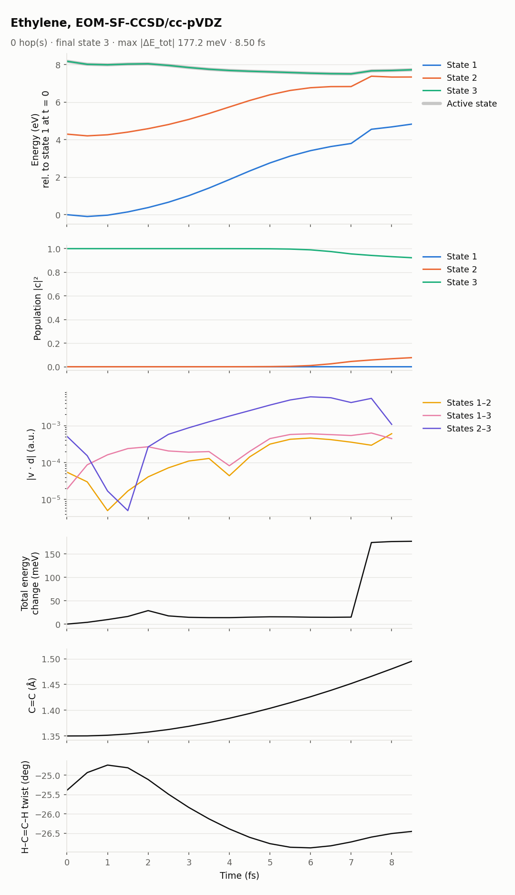
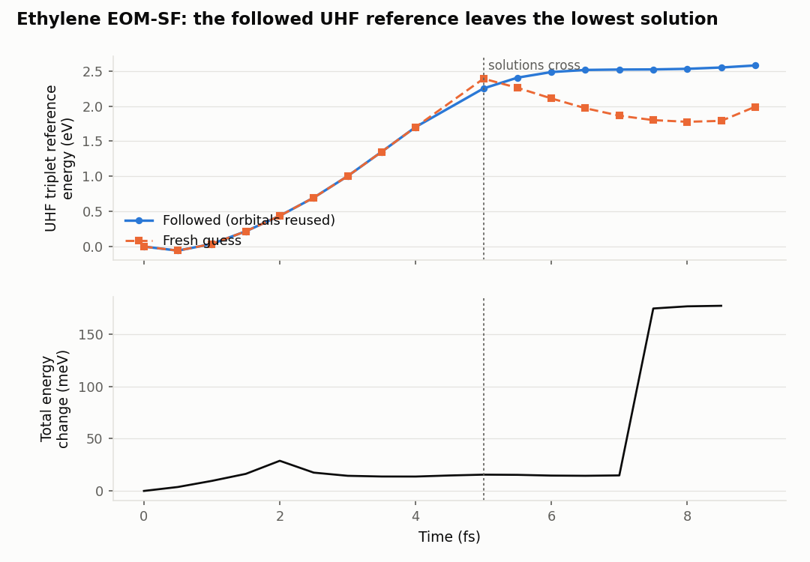

[Home](../../README.md) / [Examples](../README.md) / Ethylene, EOM-SF-CCSD

# Ethylene, EOM-SF-CCSD

Ethylene started on its bright ππ* state with spin-flip EOM-CCSD. The run stops at 9 fs, and is kept as an example of a hazard of open-shell references in dynamics: the UHF triplet reference has two stable SCF solutions that cross. Reusing orbitals between steps keeps the trajectory on the one that becomes the higher.

| Setting | Value |
|---|---|
| Method | EOM-SF-CCSD/cc-pVDZ, `SF_STATES [3]`, triplet UHF reference (charge 0, multiplicity 3) |
| States | S₀, the Ms = 0 triplet, and the ππ* singlet; start on state 3 |
| Couplings | `nac_mode` not set (`nx`): every pair, 2 Q-Chem jobs per step. EOM-SF couplings are not documented by Q-Chem; see the [tutorial](../../docs/methods/eom-sf.md) |
| Thresholds | `SCF_CONVERGENCE 9`, `CC_CONVERGENCE 8`, `EOM_DAVIDSON_CONVERGENCE 9` |
| Dynamics | dt 0.5 fs, `seed = 20261109` |
| Initial condition | 0 K Wigner sample from MP2/cc-pVDZ frequencies |
| Cost | 152 s per step on 4 cores (median Q-Chem wall time, with other jobs sharing the node; [Validation](../../docs/validation.md#7-cost-per-step-of-the-examples)) |

## Result

*Top figure: the usual overview. Bottom figure: the energy of the UHF triplet reference followed by the trajectory (orbitals reused from step to step) and of a fresh-guess UHF calculation at the same geometries, with the total-energy change below.*

- **Up to 4 fs** the followed and the fresh-guess reference are the same solution, and the total energy stays within 30 meV.
- **At about 5 fs two UHF solutions cross.** The trajectory keeps following its solution, which ends up 0.5–0.76 eV above the lowest one. Q-Chem's internal stability analysis reports the followed solution as a stable minimum, so it does not detect this.
- **At 7.5 fs the total energy jumps by 160 meV.**
- **At 9 fs CCSD on the followed reference stops converging,** and the run ends (see `RESULTS/stop_reason.txt`, copied from `DEBUG/runnx.error`). An earlier attempt with `CC_CONVERGENCE 9` stopped the same way at 8 fs.
- **How the interface detects this.** With `scf_check` (on by default for open-shell references), every step is compared with a fresh-guess SCF, and a warning is printed once the followed solution is higher. This run predates the option. The comparison in `INFO_RESTART/scf_followed_vs_fresh.dat` was computed afterwards with HF single points at the archived geometries.

ROHF would avoid UHF solution switching, but Q-Chem has no ROHF gradients. Spin-flip dynamics along twisting coordinates should therefore watch `scf_check` closely.

## Files

| Path | Contents |
|---|---|
| `control.dyn`, `sh.inp`, `jiri.inp`, `geom`, `veloc`, `qchem.par`, `JOB_NAD/qchem.inp` | Inputs |
| `RESULTS/` | NewtonX results; `stop_reason.txt` says why the run stopped (a copy of `DEBUG/runnx.error`; in your own runs, look there) |
| `INFO_RESTART/qchem_outputs/` | Q-Chem output of every step (gzipped) |
| `INFO_RESTART/scf_followed_vs_fresh.dat` | Followed and fresh-guess UHF energies per step (hartree) |
| `plots/` | Figures and summary |

## See also

- [EOM-SF tutorial](../../docs/methods/eom-sf.md)
- [Troubleshooting: the `scf_check` warning](../../docs/troubleshooting.md#warnings)
