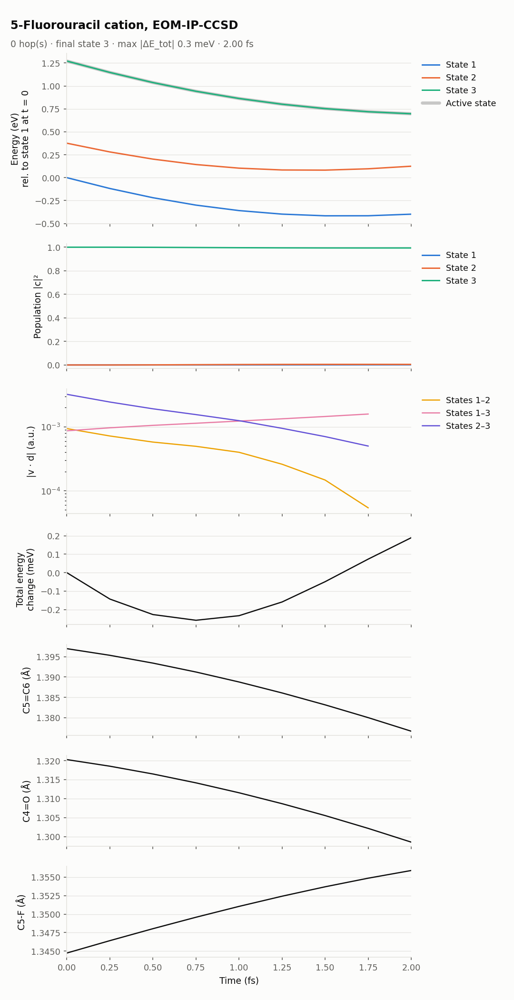

[Home](../../README.md) / [Examples](../README.md) / 5-Fluorouracil cation, EOM-IP-CCSD

# 5-Fluorouracil cation, EOM-IP-CCSD

The 5-fluorouracil radical cation started on its third ionized state. The run shows the cost of EOM-IP dynamics with all couplings for a 12-atom molecule. It is a 2 fs sample (9 steps), not a full trajectory.

| Setting | Value |
|---|---|
| Method | EOM-IP-CCSD/cc-pVDZ, `IP_STATES [3]`, closed-shell neutral reference (charge 0, multiplicity 1) |
| States | the three lowest states of the cation; start on state 3 (`nstatdyn = 3`) |
| Couplings | `nac_mode` not set (`nx`): every pair, 2 Q-Chem jobs per step |
| Thresholds | `SCF_CONVERGENCE 9`, `CC_CONVERGENCE 9`, `EOM_DAVIDSON_CONVERGENCE 9` |
| Dynamics | dt 0.25 fs, `tmax` 2 fs, `seed = 20261109` |
| Initial condition | geometry and velocities from the first step of an earlier Matsika Lab production trajectory |
| Cost | 51 min per step on 16 cores (`nt = 16`; median Q-Chem wall time, with other jobs sharing the node; [Validation](../../docs/validation.md#7-cost-per-step-of-the-examples)) |

## Result

*State energies with the active state, populations, |v·d| for each pair, total-energy change, and three bond lengths. No hops occur.*

- **Relaxation on state 3.** The gap between states 2 and 3 narrows from 0.90 to 0.57 eV. The C5=C6 and C4=O bonds shorten by 0.02 Å, and the C5–F bond lengthens by 0.01 Å.
- **No hops.** The population of state 3 is still 0.993 at 2 fs. The couplings stay between 5 × 10⁻⁵ and 3 × 10⁻³ a.u., and no "nearly orthogonal" warnings appear.
- **Energy conservation** stays within ±0.3 meV.
- **Cost.** Each Q-Chem job takes about 25 min on 16 cores. A step needs two of them, so a 100 fs trajectory at dt 0.25 fs would take about two weeks. For a trajectory of this size, consider `nac_mode = carry` or `active` (one job per step, [compared with `full`](../../docs/validation.md#coupling-modes) on methane) or `vdoth = 2`.

## Files

| Path | Contents |
|---|---|
| `control.dyn`, `sh.inp`, `jiri.inp`, `geom`, `veloc`, `qchem.par`, `JOB_NAD/qchem.inp` | Inputs |
| `RESULTS/` | NewtonX results |
| `INFO_RESTART/qchem_outputs/` | Q-Chem output of every step (gzipped) |
| `plots/overview.png`, `plots/summary.json` | Figure and summary |

## See also

- [EOM-IP tutorial](../../docs/methods/eom-ip.md)
- [Settings reference: `nac_mode`](../../docs/qchem-par.md#nac_mode)
