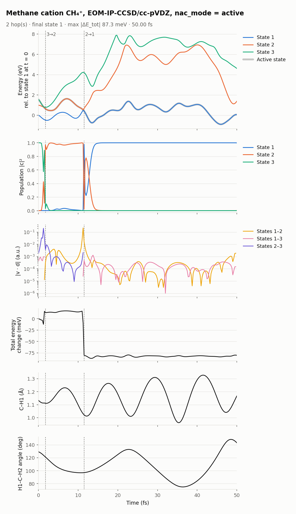

[Home](../../README.md) / [Examples](../README.md) / Methane cation, EOM-IP-CCSD, `nac_mode = active`

# Methane cation (CH₄⁺), EOM-IP-CCSD, `nac_mode = active`

The methane cation started on its third state, relaxing through the Jahn–Teller crossings of its three lowest states. This run uses `nac_mode = active`, which computes only the pairs with the active state; the pair between the two inactive states is zero. It starts from the same geometry, velocities and random seed as [`methane_cation_eomip_full`](../methane_cation_eomip_full) and [`methane_cation_eomip_carry`](../methane_cation_eomip_carry), so the three show what the cheaper [coupling modes](../../docs/couplings.md#coupling-modes) change.

| Setting | Value |
|---|---|
| Method | EOM-IP-CCSD/cc-pVDZ, `IP_STATES [3]`, neutral CH₄ reference (charge 0, multiplicity 1) |
| States | the three lowest CH₄⁺ states; start on state 3 (`nstatdyn = 3`) |
| Couplings | `nac_mode = active`: 1 Q-Chem job per step |
| Thresholds | `SCF_CONVERGENCE 9`, `CC_CONVERGENCE 9`, `EOM_DAVIDSON_CONVERGENCE 9` |
| Dynamics | dt 0.25 fs, `tmax` 50 fs, `seed = 20261109` |
| Initial condition | 0 K Wigner sample from MP2/cc-pVDZ frequencies of CH₄ |
| Cost | about 29 s per step on 4 cores (median, with other jobs sharing the node) |

## Result

*State energies with the active state, populations, |v·d| for each pair, total-energy change, one C–H distance and one H–C–H angle. Dotted lines: hops.*

- **Hops** 3 → 2 at 1.75 fs and 2 → 1 at 11.5 fs, each where the two states come within 0.04 eV of each other. The trajectory then stays on state 1 to 50 fs.
- **All three modes give the same trajectory** here: the same hops, total energies equal to within 0.01 meV at every step, and populations that differ by at most 0.006. For this trajectory, the pair that the cheaper modes skip or carry, between the two inactive states, has almost no influence. See the [comparison](../../docs/benchmarks/README.md#coupling-modes).
- **Energy conservation.** Within −12 to +17 meV up to 11 fs, and within 8 meV from 13 fs on. Between them, around the 2 → 1 hop, the total energy drops by about 95 meV over two steps. The hop itself conserves energy exactly (`RESULTS/sh.out`). The loss comes from the steps around it: S₁ and S₂ are 38 meV apart there, so the gradient of the active state changes faster than a 0.25 fs step can follow. A smaller `dt` near such crossings reduces it. All three modes have the same drop, so it does not come from the coupling mode.

## Files

| Path | Contents |
|---|---|
| `control.dyn`, `sh.inp`, `jiri.inp`, `geom`, `veloc`, `qchem.par`, `JOB_NAD/qchem.inp` | Inputs |
| `RESULTS/` | NewtonX results |
| `INFO_RESTART/qchem_outputs/` | Q-Chem output of every step (gzipped) |
| `plots/overview.png`, `plots/summary.json` | Figure and summary |

## See also

- [EOM-IP tutorial](../../docs/methods/eom-ip.md)
- [Couplings and coupling modes](../../docs/couplings.md#coupling-modes)
