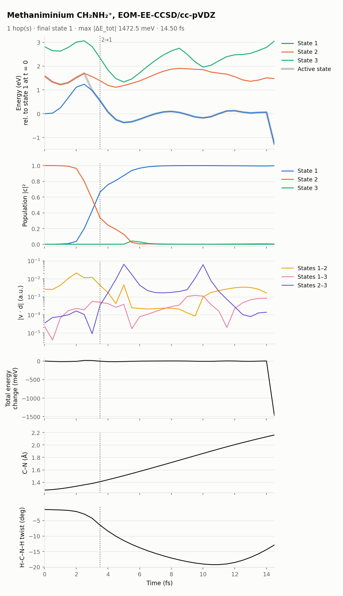

[Home](../../README.md) / [Examples](../README.md) / Methaniminium (CH₂NH₂⁺), EOM-EE-CCSD

# Methaniminium (CH₂NH₂⁺), EOM-EE-CCSD

S₂ → S₁ internal conversion of the methaniminium cation, followed by C–N bond breaking on S₁, which takes the trajectory out of the region EOM-EE can describe.

| Setting | Value |
|---|---|
| Method | EOM-EE-CCSD/cc-pVDZ, `EE_STATES [3]`, closed-shell reference (charge 1, multiplicity 1) |
| States | 3 excited singlets (S₁, S₂, S₃); start on S₂ (`nstatdyn = 2`) |
| Couplings | `nac_mode` not set (`nx`): every pair, 2 Q-Chem jobs per step |
| Thresholds | `SCF_CONVERGENCE 9`, `CC_CONVERGENCE 9`, `EOM_DAVIDSON_CONVERGENCE 9` |
| Dynamics | dt 0.5 fs, `tmax` 100 fs, `seed = 20261109` |
| Initial condition | 0 K Wigner sample from MP2/cc-pVDZ frequencies |
| Cost | 84 s per step on 4 cores (median Q-Chem wall time, with other jobs sharing the node; [Validation](../../docs/validation.md#7-cost-per-step-of-the-examples)) |

## Result

*State energies with the active state, populations, |v·d| for each pair, total-energy change, C–N distance and H–C–N–H twist. Dotted line: hop.*

- **Hop S₂ → S₁ at 3.5 fs.** Population moves smoothly, driven by a strong S₁–S₂ coupling near their crossing at about 3 fs.
- **Energy conservation** stays within ±17 meV for 14 fs.
- **C–N bond breaking on S₁.** The C–N distance grows from 1.28 to 2.16 Å.
- **End at 14.5 fs.** The closed-shell reference no longer describes the ground state, and EOM-EE state 1 falls 1.36 eV *below* the CCSD reference. NewtonX stops on the total-energy jump (see `RESULTS/stop_reason.txt`, copied from `DEBUG/runnx.error`). The interface prints `EOM-EE state 1 lies below the CCSD reference` at this step. The shipped log was made before that warning, and `tests/run_tests.sh` replays this step to check it. A fresh-guess SCF at every step gives the same reference, so this is a limit of EOM-EE here, not an SCF artifact. Dynamics that continue into this region need [EOM-SF](../../docs/methods/eom-sf.md).

## Files

| Path | Contents |
|---|---|
| `control.dyn`, `sh.inp`, `jiri.inp`, `geom`, `veloc`, `qchem.par`, `JOB_NAD/qchem.inp` | Inputs |
| `RESULTS/` | NewtonX results; `stop_reason.txt` says why the run stopped (a copy of `DEBUG/runnx.error`; in your own runs, look there) |
| `INFO_RESTART/qchem_outputs/` | Q-Chem output of every step (gzipped) |
| `plots/overview.png`, `plots/summary.json` | Figure and summary |

## See also

- [EOM-EE tutorial](../../docs/methods/eom-ee.md)
