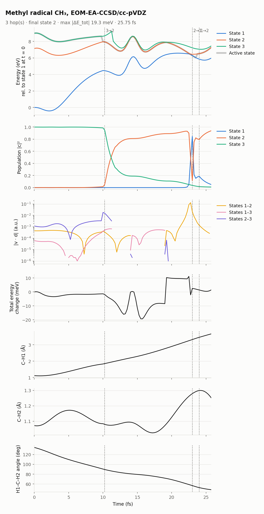

[Home](../../README.md) / [Examples](../README.md) / Methyl radical (CH₃), EOM-EA-CCSD

# Methyl radical (CH₃), EOM-EA-CCSD

The methyl radical started on its third electron-attached state, which is dissociative: one C–H bond breaks. The run shows EOM-EA dynamics with all couplings, three hops, and where the closed-shell cation reference stops working, at 26 fs.

| Setting | Value |
|---|---|
| Method | EOM-EA-CCSD/cc-pVDZ, `EA_STATES [3]`, closed-shell CH₃⁺ reference (charge 1, multiplicity 1) |
| States | the three lowest states of CH₃; start on state 3 (`nstatdyn = 3`) |
| Couplings | `nac_mode` not set (`nx`): every pair, 2 Q-Chem jobs per step |
| Thresholds | `SCF_CONVERGENCE 9`, `CC_CONVERGENCE 9`, `EOM_DAVIDSON_CONVERGENCE 9` |
| Dynamics | dt 0.25 fs, `tmax` 50 fs, `seed = 20261109` |
| Initial condition | 0 K Wigner sample from MP2/cc-pVDZ frequencies of CH₃⁺ |
| Cost | 70 s per step on 4 cores (median Q-Chem wall time, with other jobs sharing the node; [Validation](../../docs/validation.md#7-cost-per-step-of-the-examples)) |

## Result

*State energies with the active state, populations, |v·d| for each pair, total-energy change, the two C–H distances and an H–C–H angle. Dotted lines: hops.*

- **C–H dissociation.** On state 3, the C–H1 bond stretches from 1.1 Å at the start to 3.7 Å at the end, while the other two C–H bonds vibrate between 0.85 and 1.5 Å.
- **Hops.** 3 → 2 at 10.25 fs, then 2 → 1 at 23.0 fs and back 1 → 2 at 24.0 fs, where states 1 and 2 come within 0.04 eV and their coupling peaks.
- **Energy conservation** stays within ±20 meV over the whole run.
- **A state from outside the three changes the picture at 11.25 fs.** The gap between states 2 and 3 drops from 1.75 to 0.72 eV in one step, and the couplings of state 3 to states 1 and 2 fall to about 10⁻⁵ a.u. A fourth state, not included in the dynamics, has crossed below it, so "state 3" now has a different character. The interface keeps the last well-defined coupling as the sign reference instead of such near-zero vectors ([Coupling signs](../../docs/couplings.md#coupling-signs)). This run was made before that rule, so its log has nine "nearly orthogonal" warnings between 11.75 and 24.25 fs, all for these near-zero couplings. Including one more state (`EA_STATES [4]`, `nstat = 4`) would let NewtonX follow such crossings, at higher cost.
- **End at 25.75 fs.** With one C–H bond at 3.7 Å, the closed-shell CH₃⁺ reference is no longer a good single-reference description. CCSD stops converging to 10⁻⁹ (it stalls near 10⁻⁸), and Q-Chem then stops with `Key 'f2_oo_float' is not known` (see `RESULTS/stop_reason.txt`, copied from `DEBUG/runnx.error`). A looser `CC_CONVERGENCE 8` might carry it a few more steps (untested), but the reference only gets worse as the H atom leaves.

## Files

| Path | Contents |
|---|---|
| `control.dyn`, `sh.inp`, `jiri.inp`, `geom`, `veloc`, `qchem.par`, `JOB_NAD/qchem.inp` | Inputs |
| `RESULTS/` | NewtonX results; `stop_reason.txt` says why the run stopped (a copy of `DEBUG/runnx.error`; in your own runs, look there) |
| `INFO_RESTART/qchem_outputs/` | Q-Chem output of every step (gzipped) |
| `plots/overview.png`, `plots/summary.json` | Figure and summary |

## See also

- [EOM-EA tutorial](../../docs/methods/eom-ea.md)
- [Couplings](../../docs/couplings.md)
